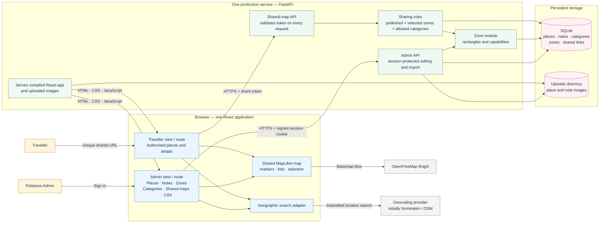

# Petassos Travel Map — proposed architecture

This scheme describes the application specified in [Petassos_Travel_Map_FINAL_Specification_v5.md](../Petassos_Travel_Map_FINAL_Specification_v5.md). It is a design, not a statement that all components are implemented.

## Main connections

| Connection | Purpose |
| --- | --- |
| Admin browser → Admin API | Manage places, internal notes, categories, zones, shared maps and CSV imports. A signed cookie identifies the shared Admin account. |
| Traveller browser → Shared-map API | Present the unique URL token. FastAPI validates it and returns only authorised published places. |
| Sharing rules → SQLite and zone module | Apply the selected zone IDs and allowed category IDs to the current place data. Changes to qualifying places or zone boundaries affect active shared maps. |
| MapLibre → OpenFreeMap | Load the Bright basemap directly in the browser. |
| Geographic search adapter → provider | Search cities and addresses on explicit user submission; results are separate from Petassos records. |
| FastAPI → SQLite / uploads | Store structured data in one database and image files in one persistent directory. |

In production, **FastAPI serves the compiled React app, API and uploads as one service**. During development, Vite may serve React separately. Admin and traveller views use the same place database and reusable map primitives; the backend is the source of truth for traveller visibility.

## Frontend routes

| URL | View |
| --- | --- |
| `/admin/login` | Admin sign-in |
| `/admin` | Admin map and management views |
| `/s/{token}` | Traveller shared map; no account required |

## API routes

These are the **indicative routes from specification §22**, not an inventory of implemented endpoints. The implementation may merge or simplify them while preserving access control. Every `/api/admin/...` route requires the Admin session, except login. Every `/api/shared/{token}...` request validates the token and applies the backend visibility rules.

| Method | Route | Purpose |
| --- | --- | --- |
| `POST` | `/api/admin/login` | Sign in and create the Admin session |
| `POST` | `/api/admin/logout` | End the Admin session |
| `GET` | `/api/admin/session` | Check the current Admin session |
| `GET` | `/api/admin/places` | Load Admin PLACE and NOTE records |
| `POST` | `/api/admin/places` | Create a PLACE or NOTE |
| `PUT` | `/api/admin/places/{id}` | Update a PLACE or NOTE |
| `DELETE` | `/api/admin/places/{id}` | Delete a PLACE or NOTE |
| `POST` | `/api/admin/places/{id}/images` | Upload an image for a PLACE or NOTE |
| `PUT` | `/api/admin/images/{id}` | Update image information, such as its caption |
| `DELETE` | `/api/admin/images/{id}` | Remove an image |
| `GET` | `/api/admin/categories` | List categories |
| `POST` | `/api/admin/categories` | Create a category |
| `PUT` | `/api/admin/categories/{id}` | Update a category |
| `DELETE` | `/api/admin/categories/{id}` | Delete an unused category |
| `GET` | `/api/admin/zones` | List saved zones |
| `POST` | `/api/admin/zones` | Create a rectangular zone |
| `PUT` | `/api/admin/zones/{id}` | Rename or reshape a zone |
| `DELETE` | `/api/admin/zones/{id}` | Delete an unused zone |
| `GET` | `/api/admin/share-links` | List shared maps |
| `POST` | `/api/admin/share-links` | Create a shared map and stable token |
| `PUT` | `/api/admin/share-links/{id}` | Edit or archive a shared map without changing its token |
| `POST` | `/api/admin/import/places/preview` | Validate a CSV and show row results |
| `POST` | `/api/admin/import/places` | Import valid new PLACE rows |
| `GET` | `/api/shared/{token}` | Read the public map title and allowed settings |
| `GET` | `/api/shared/{token}/places` | Read authorised published PLACEs only |

There is no normal `DELETE` endpoint for shared maps; they are archived through `PUT`. A separate public place-detail route is optional if the authorised place response already contains its details. Unknown tokens return `404`; expired or archived links return `410`.
